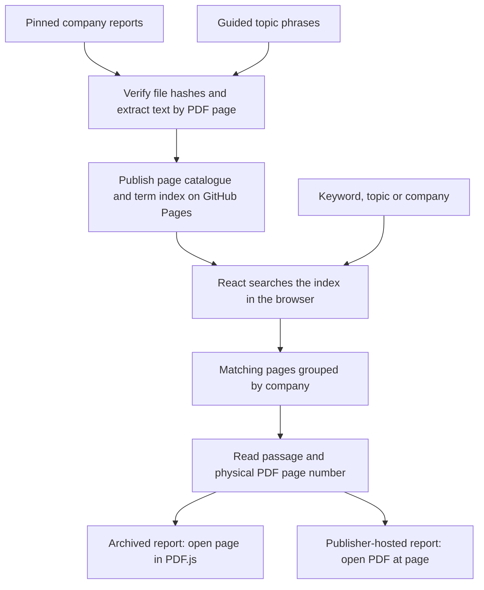
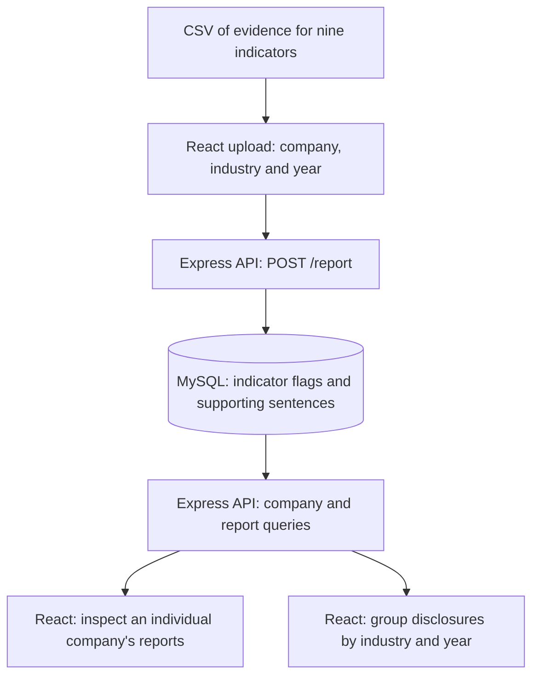

# ESG Disclosure Dashboard architecture

[Overview](README.md) · **Architecture** · [Live explorer](https://fancasta.github.io/climate-disclosure-explorer/)

A banker comparing transition plans needs a way to find a disclosure and a way to check the exact wording. The public explorer searches PDF pages in the browser. The original NatWest Markets capstone workspace stores report-level indicators and their supporting sentences in MySQL.

## How a PDF becomes a search result

The build checks each report against its recorded SHA-256 hash before indexing. It records term frequencies and topic matches against physical PDF page numbers. Seven pages have no indexable terms, leaving 3,035 searchable pages across 27 reports. The app loads the term index when a reader enters search. [Source manifest](search/sources.json) · [Index builder](search/build_index.py) · [Index loading](frontend/src/PublicDemo.js)

A free-text search requires every significant query word on the same page and ranks matches using BM25. A guided topic selects pages containing one of its phrases. The reader shows a curated passage when available or extracts text from the PDF on demand where the source permits it. The page link lets readers check charts and surrounding text in context. [Ranking and filters](frontend/src/corpusSearch.js) · [Passage selection](frontend/src/Passages.js) · [Source-page routing](frontend/src/sourcePageUrl.js)

**Try the evidence trail.** In its 2021 report, Shell set a 2030 target for emissions from operations and purchased energy. Three pages later it listed asset sales among the reasons emissions fell. A banker can use those two pages to ask how much changed at sites Shell kept operating. [Target on PDF page 92](https://fancasta.github.io/climate-disclosure-explorer/?publisher=Shell&page=92) · [Progress on PDF page 95](https://fancasta.github.io/climate-disclosure-explorer/?publisher=Shell&page=95)

## How the capstone compares companies

The research pipeline identifies candidate sentences in corporate reports. The workspace accepts a prepared CSV with one evidence row per indicator. The upload maps the rows to named fields, and the API derives flags from the supplied sentence fields. The summary counts how many reports in a group disclose each indicator. A positive net-zero flag means the report contains evidence of a pledge. The banker can inspect the sentence to judge its scope. [Research pipeline](https://github.com/fancasta/climate-disclosure-explorer) · [CSV mapping](frontend/src/components/FileUpload.js) · [Report controller](backend/controllers/report.controller.js) · [Summary calculation](frontend/src/components/disclosures.js)

For the long-term net-zero indicator, the capstone used 1,003 labelled sentences, including 196 positive examples. Model training and testing took place in the research project. The public explorer uses the page index above to retrieve evidence. [Labelled research data](https://github.com/CWei88/Group17-Capstone/blob/4ea9478a551bafa79449aa4105246ee9c9aebf75/pipeline/Notebooks/training_datasets/Attribute%2012/A12.csv)
